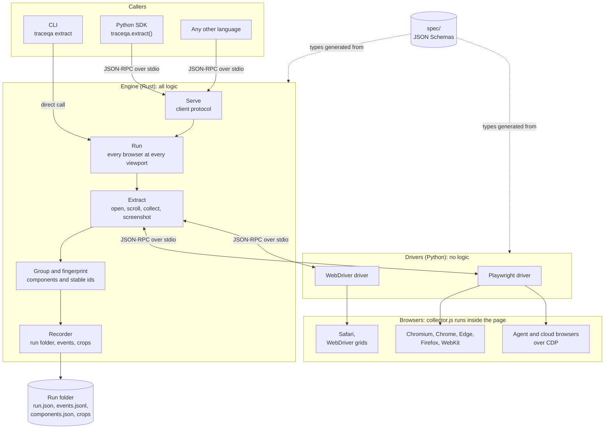

# TraceQA

Discover bugs. Forge deterministic tests. Prevent regressions.

TraceQA is a browser-agnostic QA engine. Its first capability is **component
extraction**: given a URL, it returns every interactive element on the page as
structured data and as a screenshot crop, with identifiers that stay the same
across browsers, viewports and runs.

**Status:** early release. Verified on macOS with Chromium, Firefox and WebKit.

## Contents

- [What it does](#what-it-does)
- [Quick start](#quick-start)
- [Command line](#command-line)
- [Python](#python)
- [Output](#output)
- [Browsers](#browsers)
- [Architecture](#architecture)
- [Repository layout](#repository-layout)
- [Development](#development)
- [Testing](#testing)
- [Documentation](#documentation)
- [License](#license)

## What it does

- **Finds every interactive element.** Buttons, links, inputs, selects,
  editable regions, and elements that only look clickable.
- **Reads the whole page.** Open shadow DOM, same-origin and cross-origin
  iframes, and content that loads on scroll.
- **Groups repeats into components.** Twelve "Add to cart" buttons are one
  component with twelve instances.
- **Assigns stable identifiers.** A component has the same id in every browser,
  at every viewport, on every run.
- **Records state and evidence.** Role, accessible name, selectors, position,
  visibility and enabled state. With `--crops`, a cropped screenshot per
  component too.
- **Runs the same way everywhere.** One in-page collector is used for every
  browser, so results are directly comparable.
- **Runs browsers side by side.** A run takes about as long as its slowest
  browsers, and reports where each one spent its time.
- **Works from any language.** The engine is a standalone program that speaks a
  documented JSON protocol. A Python SDK is included.

Extraction reads the page in its current state. It does not click, type or
navigate, and it makes no network calls of its own beyond loading the page.

## Quick start

Requirements: [Rust](https://rustup.rs) (stable) and
[uv](https://docs.astral.sh/uv/).

```sh
cargo build
uv sync
uv run playwright install chromium firefox webkit
```

Run it against the bundled demo site:

```sh
# Terminal 1
uv run python fixtures/buggy-shop/serve.py

# Terminal 2
uv run cargo run -- extract http://127.0.0.1:4173/ --browser chromium,firefox,webkit
```

`uv run` places the browser drivers on `PATH`, which is where the engine looks
for them.

## Command line

```sh
traceqa extract https://example.com \
    --browser chromium,firefox,webkit \
    --viewport 1280x800,390x844
```

```
TARGET                   STATUS     COMPONENTS INSTANCES WARNINGS    TIME
chromium-1280x800        completed          37        67        1    3.8s
chromium-390x844         completed          37        67        1    2.7s
firefox-1280x800         completed          37        67        1    4.8s
firefox-390x844          completed          37        67        1    4.1s
webkit-1280x800          completed          37        67        1    4.0s
webkit-390x844           completed          37        67        1    3.0s

Run folder: runs/r_20261013_162841_e4f0
```

Every browser is run at every viewport, several at a time. Add `--crops` to
also save a picture of each component. See [docs/usage.md](docs/usage.md) for
all options.

## Python

```python
import traceqa

result = traceqa.extract(
    "https://example.com",
    browsers=["chromium", "firefox"],
    viewports=[(1280, 800), (390, 844)],
    on_event=lambda event: print(event.message),
)

for target in result.targets:
    for component in result.components(target.dir).components:
        print(component.id, component.role, component.name, len(component.instances))
```

The SDK contains no logic. It starts the engine, exchanges messages with it and
returns typed results.

## Output

Each run writes one folder:

```
runs/<runId>/
  run.json                   summary of the run and of each target
  events.jsonl               one event per line, in order
  <browser>-<width>x<height>/
    components.json          every component found
    page.png                 screenshot of the page    (with --crops)
    crops/<componentId>.png  one crop per component    (with --crops)
```

A component in `components.json`:

```json
{
  "id": "c_54751a251306",
  "role": "button",
  "name": "Add to cart",
  "nameIsTemplate": false,
  "confidence": "high",
  "signals": ["native"],
  "path": "main > list \"Products\" > listitem",
  "crop": "crops/c_54751a251306.png",
  "instances": [
    {
      "key": "c_54751a251306:0",
      "name": "Add to cart",
      "tag": "button",
      "attrs": { "type": "button" },
      "selectors": ["#grid > li:nth-of-type(1) > button"],
      "box": { "x": 119.0, "y": 682.5, "w": 232.0, "h": 18.0 },
      "state": { "visible": true, "enabled": true, "inViewport": true },
      "frameId": "main",
      "inShadowDom": false
    }
  ]
}
```

The formats are defined in [spec/](spec/README.md).

## Browsers

| `--browser` value | Driver | Notes |
|---|---|---|
| `chromium`, `chrome`, `msedge`, `firefox`, `webkit` | Playwright | Launched by the driver. |
| `cdp=ENDPOINT` | Playwright | Attaches to a running browser that exposes the Chrome DevTools Protocol, such as an agent or cloud browser. |
| `safari` | WebDriver | Real Safari on macOS through `safaridriver`. Requires "Allow remote automation" in Safari's Developer settings. |
| `webdriver=URL` | WebDriver | Any W3C WebDriver server or cloud grid. |

The engine contains no browser names. It asks each configured driver which
browsers it can open, and adapts to the capabilities the driver reports. A new
browser is supported by adding a driver.

## Architecture



- **Engine.** One Rust binary that holds all logic: orchestration, grouping,
  identifiers and output.
- **Drivers.** Separate programs that control browsers and make no decisions.
- **Collector.** A single JavaScript file evaluated inside the page. It reports
  facts about elements and nothing else.
- **Contracts.** JSON Schemas in `spec/` define every message and file format.
  The Rust and Python types are generated from them.

See [docs/architecture.md](docs/architecture.md) for the message flow and the
design decisions.

## Repository layout

| Path | Purpose |
|---|---|
| `spec/` | Contracts: protocols, file formats, the identifier recipe, examples. |
| `collector/` | The in-page script. |
| `crates/traceqa-protocol/` | Rust types generated from `spec/`, and the message line format. |
| `crates/traceqa-engine/` | The engine library. |
| `crates/traceqa-recorder/` | Run folder, event log and screenshot crops. |
| `crates/traceqa-cli/` | The `traceqa` command. |
| `drivers/playwright-py/` | Driver for Chromium, Edge, Firefox, WebKit and CDP endpoints. |
| `drivers/webdriver-py/` | Driver for Safari and W3C WebDriver servers. |
| `python/traceqa-protocol/` | Python types generated from `spec/`, and the driver request loop. |
| `sdks/python/` | The `traceqa` Python package. |
| `fixtures/buggy-shop/` | Demo site with a manifest of its expected components. |
| `bench/` | Scores extraction against the demo site. |
| `scripts/` | Code generation. |
| `docs/` | Architecture, usage and project plan. |

## Development

After editing a schema in `spec/`, run `uv run scripts/gen_python_protocol.py`
to regenerate the Python types. The Rust types regenerate on build.

## Testing

```sh
cargo test                # the Rust crates
uv run pytest             # the drivers, the protocol package and the SDK
uv run bench/run.py       # the whole tool, end to end, on the demo site
```

Every part of the repository has tests:

| Part | How it is tested | Run with |
|---|---|---|
| `crates/traceqa-protocol` | Every example in `spec/examples/` must parse as its type and survive a round trip. Message encoding and decoding. | `cargo test` |
| `crates/traceqa-engine` | Grouping, identifiers, driver command parsing and the client server as unit tests. Whole runs against a scripted driver, including a failed page load, a driver that stops answering, a failed screenshot and a cancelled run. | `cargo test` |
| `crates/traceqa-recorder` | Event log, timestamps, run ids and crop geometry. | `cargo test` |
| `crates/traceqa-cli` | Argument parsing as unit tests. The built binary is run by the SDK tests and the bench. | `cargo test`, `uv run pytest` |
| `python/traceqa-protocol` | The same `spec/examples/` check as the Rust crate, so both languages read the contracts the same way. The driver request loop. | `uv run pytest` |
| `drivers/playwright-py` | The real driver process against the demo site in Chromium, Firefox and WebKit, and attached to a running browser over CDP. | `uv run pytest` |
| `drivers/webdriver-py` | The real driver process against the demo site through chromedriver. A Safari test runs when `TRACEQA_TEST_SAFARI=1`. | `uv run pytest` |
| `sdks/python` | The SDK through the real binary and a real browser, including cancelling a run part-way. | `uv run pytest` |
| `collector/collector.js` | Runs inside real browsers in the driver tests and the bench, which compare what it finds with the demo site's manifest. | `uv run pytest`, `uv run bench/run.py` |
| `fixtures/buggy-shop` | Its manifest is the bench's answer key. | `uv run bench/run.py` |

The WebDriver test needs chromedriver: put it on `PATH` or set
`TRACEQA_CHROMEDRIVER`. Without it that test is skipped locally.

### Continuous integration

`.github/workflows/ci.yml` runs on every pull request and on pushes to `master`.

| Job | Runs on | What it does |
|---|---|---|
| Lint | Linux | `cargo fmt --check`, `cargo clippy`, `ruff check`, `ruff format --check`, and a check that the generated Python types match `spec/`. |
| Test | Linux, macOS and Windows | `cargo test`, builds the release binary and starts it, installs the browsers, runs `uv run pytest` and the bench against that binary. |

Each Test job uploads the release binary it built (`traceqa-linux-x86_64`,
`traceqa-macos-arm64`, `traceqa-windows-x86_64`) and its bench scores as
artifacts of the run.

The same checks, locally:

```sh
cargo fmt --all --check
cargo clippy --all-targets -- -D warnings
uv run ruff check .
uv run ruff format --check .
uv run scripts/gen_python_protocol.py --check
```

## Documentation

- [docs/usage.md](docs/usage.md): command-line options, the Python SDK, output
  files, warnings and exit codes.
- [docs/architecture.md](docs/architecture.md): components, message flow and
  design decisions.
- [spec/README.md](spec/README.md): the contracts and the rules for changing them.
- [spec/fingerprint.md](spec/fingerprint.md): how component identifiers are built.
- [docs/PLAN.md](docs/PLAN.md): project plan and status.

## License

Apache-2.0. See [LICENSE](LICENSE).
