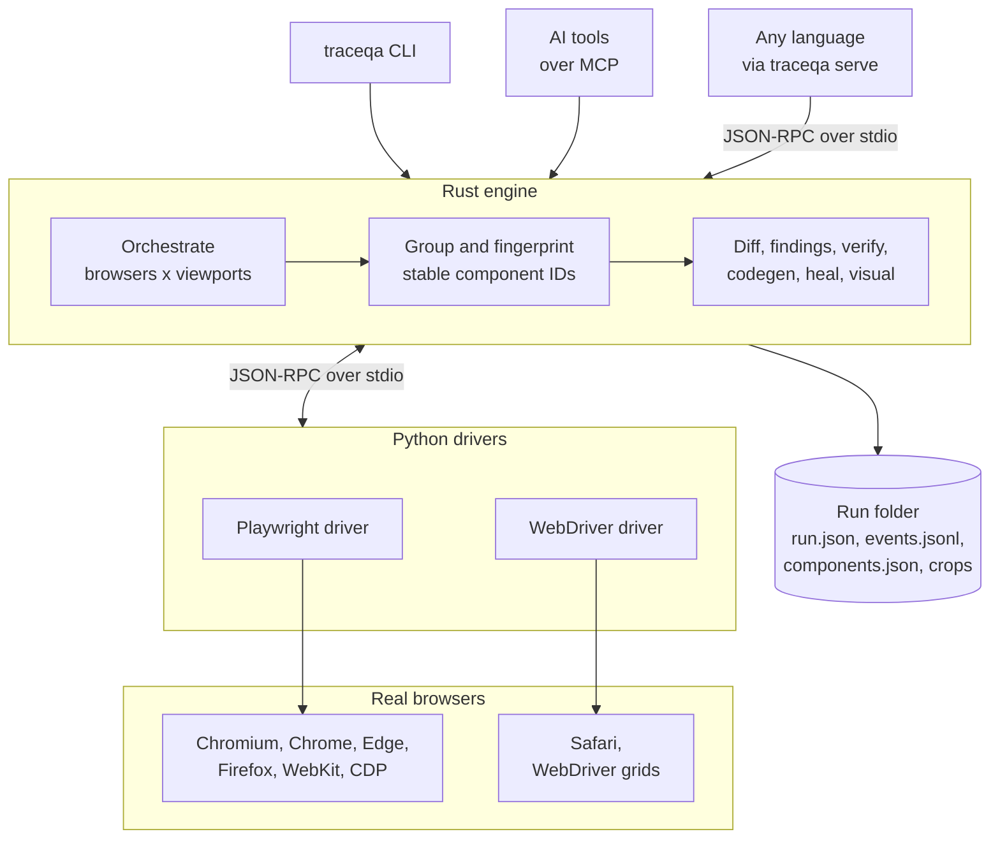
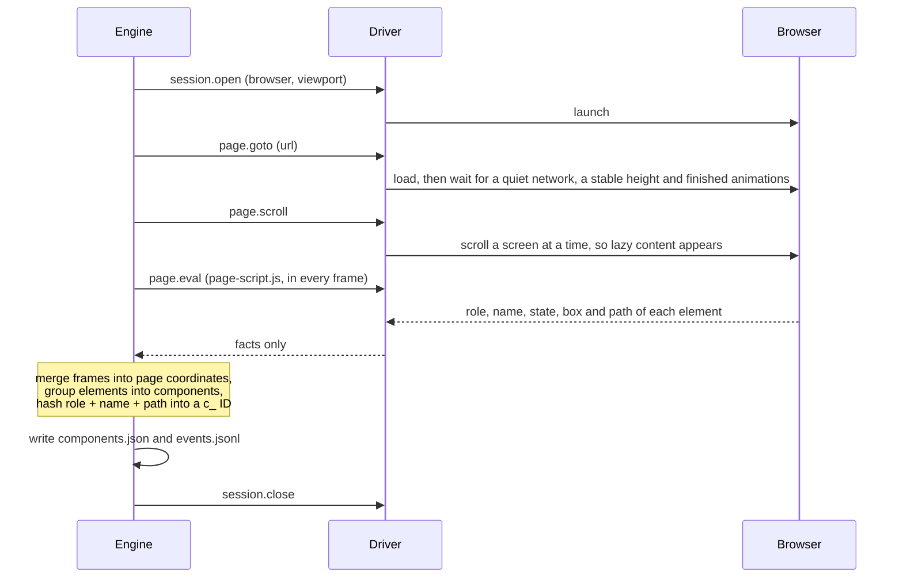
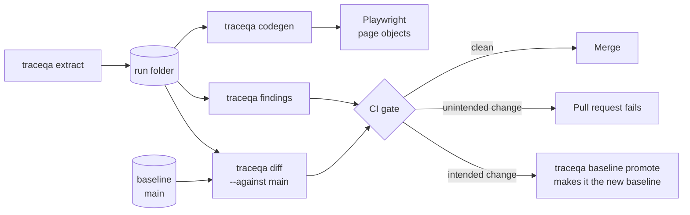

<div align="center">

# TraceQA

**Discover bugs. Forge deterministic tests. Prevent regressions.**

TraceQA opens your web page in real browsers, finds every control a person can use,<br/>
and gives each one an ID that stays the same across browsers, screen sizes and builds.

[](https://github.com/thearpankumar/TraceQA/actions/workflows/ci.yml)
[](https://github.com/thearpankumar/TraceQA/actions/workflows/audit.yml)
[](LICENSE)
[](Cargo.toml)
[](pyproject.toml)
[](#installation)

[See it in action](#see-it-in-action) · [Features](#features) · [Architecture](#architecture) · [Install](#installation) · [Docs](#documentation)

</div>

---

## What is TraceQA

Every web test starts with the same question: *what is on this page, and how do I reach it?* Usually someone
clicks through the page in one browser, copies selectors by hand, and the tests break the next time the page or
the browser changes.

TraceQA answers that question for you. Give it a URL, and it loads the page in Chromium, Firefox, WebKit, Safari
or a WebDriver grid, at every screen size you ask for. It scrolls the whole page, reads inside frames and shadow
DOM, and lists everything a person can interact with: buttons, links, fields and widgets, each with its role,
accessible name, state and a ready-to-use Playwright locator.

The key step comes next. Repeated elements are grouped into **components**, and each component gets an **ID
that does not change** across browsers, screen sizes and runs. A page becomes data you can diff, gate, test and
hand to an AI.

<table>
<tr>
<td width="33%" valign="top">

### Discover

Accessibility and quality checks attached to real components: unnamed controls, fake buttons, tiny targets,
browsers that disagree, plus axe-core.

</td>
<td width="33%" valign="top">

### Forge

Playwright page objects in TypeScript or Python, generated from what the page actually contains. When the page
changes, `traceqa heal` repairs the locators.

</td>
<td width="33%" valign="top">

### Prevent

Save a baseline, compare every build against it, and fail the pull request when a control disappears, gets
disabled or gets covered.

</td>
</tr>
</table>

> [!NOTE]
> TraceQA is pre-1.0. The command line and the file formats are versioned and may still change.

## See it in action

The repository ships a demo shop full of deliberate bugs. One command reads it in three browser engines at
desktop and phone sizes:

```console
$ traceqa extract http://127.0.0.1:4173/ --browser chromium,firefox,webkit --viewport 1280x800,390x844

TARGET                   STATUS     COMPONENTS INSTANCES WARNINGS    TIME
chromium-1280x800        completed          37        67        1   14.3s
chromium-390x844         completed          37        67        1   14.3s
firefox-1280x800         completed          37        67        1   23.5s
firefox-390x844          completed          37        67        1   23.5s
webkit-1280x800          completed          37        67        1    7.2s
webkit-390x844           completed          37        67        1    7.1s
```

Six browser and size combinations find the same 37 components, with the same IDs. Run the checks on the result:

```console
$ traceqa findings runs/r_20261025_202132_e41c

chromium-1280x800: 3 errors, 2 warnings, 1 info
SEVERITY RULE                   COMPONENT       ROLE       NAME                     FINDING
error    unnamed-control        c_22db864e0a14  button                              A button has no accessible name, so a screen reader announces it without saying what it does.
error    fake-button            c_015589123eaf  generic    Dismiss                  This element acts like a button (a pointer cursor or a click handler) but is not a button or link and cannot be reached with the keyboard.
error    fake-button            c_cf32bca1f4ff  generic    See today's offers       This element acts like a button (a pointer cursor or a click handler) but is not a button or link and cannot be reached with the keyboard.
warning  small-target           c_1d776447f7e3  button     कार्ट देखें              The target is 62.1x23 CSS pixels, below the 24x24 minimum, and sits close to other targets.
warning  small-target           c_38a4abbc53b5  link       تواصل معنا               The target is 76.5x21 CSS pixels, below the 24x24 minimum, and sits close to other targets.
info     missing-autocomplete   c_7e3842decc6b  textbox    Email address            This email field has no autocomplete attribute, so browsers and assistive tools cannot fill it in for the person.
```

Then turn the result into a page object (`traceqa codegen runs/r_20261025_202132_e41c --lang ts`):

```ts
// traceqa:id c_663c9dccbb31
// role: "button", name: "Search"
get searchButton(): Locator {
  return this.page.getByRole("button", { name: "Search", exact: true });
}

// traceqa:id c_22db864e0a14
// role: "button", name: ""
get button_22db86(): Locator {
  return this.page.locator("#cart-btn");
}
```

The unnamed cart button is `c_22db864e0a14` in every browser, at every size, in every run. When a later build
fixes it, or breaks something else, `traceqa diff` reports exactly which component changed.

## Features

<table>
<tr>
<td width="50%" valign="top">

### Sees the whole page

- Every button, link, input, select, editable region and ARIA widget, plus elements that only *look* clickable.
- Open shadow DOM, same- and cross-origin iframes, and content that loads as you scroll.
- Marks what is hidden, disabled, or covered by a cookie banner or modal.
- Read-only: it loads and scrolls, and never clicks, types or submits.

</td>
<td width="50%" valign="top">

### Every browser, every size, one run

- Chromium, Chrome, Edge, Firefox, WebKit, real Safari, a running browser over CDP, or any WebDriver grid.
- All of them side by side, at every viewport you list.
- One browser failing never stops the others, and a timed-out one is retried alone.
- Ctrl-C stops quickly and still leaves a valid run folder.

</td>
</tr>
<tr>
<td width="50%" valign="top">

### IDs that do not drift

- An ID comes from role, normalised name and structural path, never from position, CSS classes, browser or size.
- Twelve "Add to cart" buttons are one component with twelve instances, and product cards collapse to one template.
- Counters and countdowns keep their ID while their text changes.
- `extract --repeat N` reads a page N times and flags components that come and go.

</td>
<td width="50%" valign="top">

### A regression gate for CI

- `traceqa baseline` keeps a reference run you commit to the repository.
- `traceqa diff --against main --fail-on removed,disabled` fails the build on the changes you choose.
- GitHub annotations and SARIF output, `verify` manifests of what must exist, and per-component pixel compare.
- `traceqa map` follows a site's links and lists which components live on which pages.

</td>
</tr>
<tr>
<td width="50%" valign="top">

### Accessibility and quality findings

- Built-in checks: unnamed controls, weak names, fake buttons, small targets, covered controls, ambiguous links,
  missing autocomplete, and browsers that disagree.
- axe-core results placed on the component they belong to.
- Suppressions with a reason and an expiry date, and a `--fail-on` gate.

</td>
<td width="50%" valign="top">

### Tests from a run

- `traceqa codegen` writes Playwright page objects in TypeScript or Python, one property per component.
- `traceqa heal` compares a run with a baseline, patches locators that moved, and proposes renames that are
  applied only with `--accept`.
- Every property carries its `traceqa:id`, so tools can find it and update it.

</td>
</tr>
<tr>
<td width="50%" valign="top">

### Built for AI tools

- `traceqa mcp` gives Claude Code, Cursor and other MCP clients eight tools: extract, find, describe a page,
  diff runs, run findings, fetch a component's picture and more.
- Page text is marked untrusted, and cloud metadata addresses are refused.
- Remote browsers and saved sign-ins are off until the operator allows them.

</td>
<td width="50%" valign="top">

### Safe with real sites

- `traceqa login` saves a sign-in once, and the saved state is never written to a run folder.
- Tokens, passwords and signatures in addresses become `REDACTED` in every file.
- `traceqa serve` speaks a documented JSON-RPC protocol over standard input and output, so any language can
  drive the engine.

</td>
</tr>
</table>

The full list, one line per feature, is in [docs/features.md](docs/features.md).

## Vision

Testing tools usually make you choose. Hand-written scripts are precise but break whenever the page changes. AI
agents adapt to change, but they rarely do the same thing twice. TraceQA starts from a different idea: **a web
page can be read as data.** Once every component has a stable identity, exploring, judging, testing and gating
all become repeatable and explainable.

## What makes it different

| The usual way | The TraceQA way |
|---|---|
| Record clicks in one browser and get selectors for whatever you happened to touch. | Read the whole page in every browser and get a locator for **everything**, without clicking anything. |
| Compare screenshots pixel by pixel: a new font fails the build, and a missing button is lost in the noise. | Compare **components**: added, removed, renamed, disabled, hidden or covered. Pixel compare is optional and per component. |
| Run accessibility rules and get a list of DOM nodes that shifts with every build. | Findings are attached to **component IDs**, so you can track, suppress and gate them across builds. |
| Let an AI agent click around, and get something different every run. | Same page, same IDs, every run. AI tools get **structured, deterministic data** over MCP. |
| Run one browser at a time and glue the results together with scripts. | Run Chromium, Firefox, WebKit, Safari and grids **side by side in one run**, and compare them by component. |

Four principles hold it together:

- **Deterministic.** The same page gives the same components and the same IDs.
- **Read-only by default.** It observes the page and never changes anything on it.
- **One brain.** The Rust engine makes every decision. Drivers only carry out instructions, so every browser is
  treated the same.
- **Contracts first.** Every message and file is defined by a JSON Schema, and the Rust and Python types are
  generated from those schemas, so the languages cannot drift apart.

## Architecture

TraceQA is a small set of programs that exchange messages. The engine, a single Rust binary, makes every decision.
Browser drivers are separate Python processes that do what they are told. A plain JavaScript file runs inside
the page and reports facts.



Every message between these programs, and every file they write, is defined once as a JSON Schema in
[`spec/`](spec). The CLI and the MCP server call the engine directly. Everything else talks to it in JSON-RPC,
one message per line.

### One extraction, step by step

For every browser at every viewport:



### How you use it every day



<details>
<summary><b>Repository map</b></summary>

| Path | What lives there |
|---|---|
| [`crates/traceqa-cli`](crates/traceqa-cli) | The `traceqa` binary, one module per command. |
| [`crates/traceqa-engine`](crates/traceqa-engine) | All the logic: orchestration, grouping and component IDs. |
| [`crates/traceqa-common`](crates/traceqa-common) | Types generated from `spec/`, the JSON-RPC line format and shared helpers. |
| [`crates/traceqa-recorder`](crates/traceqa-recorder) | Writes the run folder and the live event stream. |
| [`crates/traceqa-diff`](crates/traceqa-diff) | Compares two runs by component ID. |
| [`crates/traceqa-findings`](crates/traceqa-findings) | The accessibility and quality checks. |
| [`crates/traceqa-heal`](crates/traceqa-heal) | Sorts what a run lost against a baseline into fixes, renames and failures. |
| [`crates/traceqa-visual`](crates/traceqa-visual) | Compares component pictures pixel by pixel. |
| [`crates/traceqa-mcp`](crates/traceqa-mcp) | The MCP server for AI tools. |
| [`crates/traceqa-replay`](crates/traceqa-replay) | A stand-in engine that replays recorded conversations, for testing clients. |
| [`page-script`](page-script) | `page-script.js`, which runs inside the page and reports what it finds. |
| [`web-drivers`](web-drivers) | The Playwright and WebDriver drivers, and `traceqa-protocol`, their shared generated types. |
| [`spec`](spec) | JSON Schemas for every message and file, with examples, transcripts and the ID recipe. |
| [`testbed`](testbed) | Demo sites, including the buggy shop, and the end-to-end bench. |
| [`tests`](tests) | End-to-end, driver, MCP and installer tests. |
| [`scripts`](scripts) | Code generation and CI helpers. |

</details>

The full design, including both protocols and the reasons behind each decision, is in
[docs/architecture.md](docs/architecture.md).

## Installation

### 1. Get the `traceqa` binary

**One line.** The installer downloads the newest [release](https://github.com/thearpankumar/TraceQA/releases)
for your system, checks it against the release's `SHA256SUMS.txt`, puts `traceqa` in `~/.local/bin` and adds
that folder to your PATH.

```sh
# Linux and macOS
curl -LsSf https://raw.githubusercontent.com/thearpankumar/TraceQA/master/scripts/install.sh | sh
```

```powershell
# Windows
irm https://raw.githubusercontent.com/thearpankumar/TraceQA/master/scripts/install.ps1 | iex
```

Pin a version with `| sh -s -- --version v0.1.0`, choose the folder with `--install-dir`, and keep your shell
profile untouched with `--no-modify-path`. The options and their environment variables are listed at the top of
[install.sh](scripts/install.sh) and [install.ps1](scripts/install.ps1).

**By hand.** Each release has archives for Linux x86-64, macOS on Apple silicon and Windows x86-64, a
`SHA256SUMS.txt`, and signed build provenance you can check:

```sh
gh attestation verify traceqa-v0.1.0-linux-x86_64.tar.gz --repo thearpankumar/TraceQA
```

**From source**, with Rust 1.88 or later:

```sh
git clone https://github.com/thearpankumar/TraceQA
cd TraceQA
cargo install --path crates/traceqa-cli --locked
```

### 2. Install the browsers

TraceQA needs [uv](https://docs.astral.sh/uv/), which it uses to set up its drivers in `~/.traceqa`, away from
your own projects:

```sh
traceqa install chromium firefox webkit
traceqa doctor
```

`doctor` checks the setup and says how to fix anything that is missing. On Linux, add `--with-deps` to install
the browsers' system libraries. In a source checkout, `traceqa install --from .` installs the drivers from the
checkout instead of GitHub.

### 3. Read your first page

```sh
traceqa extract https://example.com --browser chromium,firefox --viewport 1280x800,390x844
traceqa findings runs/<run-id>
traceqa codegen runs/<run-id> --lang ts
```

### Use it from an AI tool

```sh
claude mcp add traceqa -- traceqa mcp
```

Other MCP clients start the program `traceqa` with the argument `mcp`.

### Gate your pull requests

```sh
traceqa baseline save runs/<run-id> --name main
traceqa diff runs/<new-run-id> --against main --fail-on removed,disabled --format github
```

A complete GitHub Actions job is in [docs/usage.md](docs/usage.md#baselines-and-the-ci-gate).

## Documentation

| Document | Read it for |
|---|---|
| [Usage](docs/usage.md) | Every command, option, exit code and output file. |
| [Features](docs/features.md) | Everything TraceQA can do, one line each. |
| [Architecture](docs/architecture.md) | How the engine, drivers and page script fit together, and why. |
| [Clients](docs/clients.md) | Driving the engine from any language with `traceqa serve`. |
| [Testing](docs/testing.md) | Mutation testing of the component ID and checks of the generated page objects. |
| [Backlog](docs/backlog.md) | Designed but not built yet: the explorer, interaction oracles and more. |
| [Contracts](spec/README.md) | The JSON Schemas, their versions and the rules for changing them. |
| [Component IDs](spec/fingerprint.md) | The exact ID recipe and its known limits. |
| [Security](docs/SECURITY.md) | How to report a vulnerability privately. |
| [Third-party notices](docs/third-party-notices.md) | Licences of the code TraceQA ships. |

## Development and testing

Set up the repository (needs Rust stable and uv):

```sh
cargo build
uv sync
uv run playwright install chromium firefox webkit
```

Run the tests: the Rust crates, then the Python suites, then the end-to-end bench on the demo shop:

```sh
cargo test
uv run pytest
uv run testbed/bench/run.py
```

Run the linters:

```sh
uv run ruff check .
uv run ruff format --check .
uv run pyright
```

Start the demo shop at http://127.0.0.1:4173/ to try the commands above:

```sh
uv run python testbed/sites/buggy-shop/serve.py
```

Every command works unchanged in Bash, PowerShell and cmd. CI runs the tests on Linux, macOS and Windows.

The [devcontainer](.devcontainer) has Rust, uv, Node and the three browsers ready: open the folder in VS Code and
choose *Reopen in Container*.

## Security

Please report vulnerabilities privately, as described in [docs/SECURITY.md](docs/SECURITY.md).

## License

TraceQA is licensed under the [Apache License 2.0](LICENSE). Third-party licences are listed in
[docs/third-party-notices.md](docs/third-party-notices.md).
