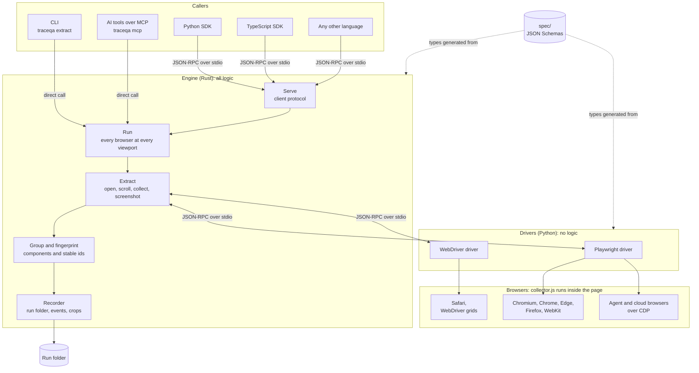

# TraceQA

**Discover bugs. Forge deterministic tests. Prevent regressions.**

TraceQA is a browser-agnostic, agentic quality assurance engine for web
applications. It reads a web page in real browsers, understands every
interactive element on it, and produces structured, comparable results that
people, test suites and AI agents can act on.

> **Status:** early release. The first capability, component extraction, is
> complete and tested on macOS, Windows and Linux. Exploration, check mode and
> sweep mode are on the [roadmap](#roadmap).

## Contents

- [What is TraceQA](#what-is-traceqa)
- [Key capabilities](#key-capabilities)
- [Supported platforms and browsers](#supported-platforms-and-browsers)
- [Installation](#installation)
- [Quick start](#quick-start)
- [Ways to use TraceQA](#ways-to-use-traceqa)
- [Architecture](#architecture)
- [Repository layout](#repository-layout)
- [Development and testing](#development-and-testing)
- [Roadmap](#roadmap)
- [Documentation](#documentation)
- [License](#license)

## What is TraceQA

Testing a web application across browsers and screen sizes is slow, manual and
inconsistent. Each browser behaves a little differently, and test scripts break
whenever the page changes.

TraceQA approaches this from the page itself. Given a URL, it opens the page in
every requested browser at every requested screen size, and builds a precise
inventory of what a user can interact with: every button, link, input and
control, with its role, accessible name, state, position and a picture of it.

Every element receives an **identifier that stays the same across browsers,
screen sizes and runs**. That makes results directly comparable. The same
"Add to cart" button in Chrome on a desktop and in Safari on a phone is
recognised as the same component, so differences between them are real
differences on the page.

This inventory is the foundation for the rest of the product. An explorer will
interact with these components, and check and sweep modes will turn what it
finds into bug reports and deterministic tests.

## Key capabilities

| Capability | Description |
|---|---|
| Complete element discovery | Buttons, links, inputs, selects, editable regions, and elements that only look clickable. |
| Whole-page coverage | Open shadow DOM, same-origin and cross-origin iframes, and content that loads as the page scrolls. |
| Stable identifiers | The same component has the same id in every browser and on every run, and across screen sizes unless the layout moves it under a differently named landmark. |
| Component grouping | Repeated elements, such as twelve "Add to cart" buttons in a product grid, become one component with twelve instances. |
| Evidence | Role, accessible name, selectors, position, visibility and state for each element, and an optional cropped screenshot. |
| Parallel execution | Browsers and screen sizes run side by side, with a time breakdown for each. |
| Consistent results | One in-page collector runs in every browser, so results are measured the same way everywhere. |
| AI agent ready | A built-in MCP server lets AI tools such as Claude Code and Cursor run TraceQA and inspect its results. |
| Any language | A documented protocol, with Python and TypeScript SDKs and a guide for others. |
| Non-invasive | It navigates to the URL and scrolls to load lazy content. With `--storage-state` it first sets cookies and local storage. It never clicks, types or submits anything. |

## Supported platforms and browsers

**Operating systems:** macOS, Windows and Linux, from a single codebase. Every
change is tested on all three in continuous integration.

| Browser | How it is driven |
|---|---|
| Chromium, Google Chrome, Microsoft Edge | Playwright |
| Firefox | Playwright |
| WebKit | Playwright |
| Safari | WebDriver, through `safaridriver` on macOS. Tested on Safari 26. |
| Agent and cloud browsers | Chrome DevTools Protocol endpoint (`cdp=ENDPOINT`) |
| Selenium grids and cloud device farms | Any W3C WebDriver server (`webdriver=URL`) |

## Installation

### Prerequisites

| Requirement | Needed for |
|---|---|
| [Rust](https://rustup.rs), stable | Building the `traceqa` binary |
| [uv](https://docs.astral.sh/uv/) | Installing the browser drivers |
| [Git](https://git-scm.com) | Getting the source |
| [Node.js](https://nodejs.org) 24 or later | Only for the TypeScript SDK |

Install uv if it is not already present:

```sh
# macOS and Linux
brew install uv        # or: pipx install uv

# Windows
winget install --id=astral-sh.uv -e
```

Other ways, including a versioned installer with its published checksum, are on
[uv's installation page](https://docs.astral.sh/uv/getting-started/installation/).

### Step 1: Install the traceqa binary

Each tagged version publishes binaries for macOS, Windows and Linux on the
repository's [Releases](https://github.com/thearpankumar/TraceQA/releases)
page. Download the archive for your system, extract it, and put `traceqa` on
your `PATH`. Then run `traceqa install chromium firefox webkit` and skip to
step 3.

Every archive and `SHA256SUMS.txt` carries a build provenance attestation, signed through GitHub, that this
repository's release workflow built that exact file. To check a download with the GitHub CLI:

```sh
gh attestation verify traceqa-v0.1.0-linux-x86_64.tar.gz --repo thearpankumar/TraceQA
sha256sum -c SHA256SUMS.txt --ignore-missing
```

The binaries are not yet code-signed. On macOS, allow a downloaded binary with
`xattr -d com.apple.quarantine traceqa`. On Windows, SmartScreen may ask for
confirmation the first time it runs.

Until the first release, or to build the latest code, install from source:

```sh
git clone https://github.com/thearpankumar/TraceQA.git
cd TraceQA
cargo install --locked --path crates/traceqa-cli
```

This places `traceqa` in Cargo's binary folder (`~/.cargo/bin`), which rustup
adds to `PATH`.

### Step 2: Install the drivers and browsers

From the same folder:

```sh
traceqa install --from . chromium firefox webkit
```

This creates a private Python environment in `~/.traceqa`, installs the browser
drivers into it at the versions the repository was tested with, and downloads
the browsers. It does not affect other Python projects on the machine.

On Linux, add `--with-deps` to also install the system libraries the browsers
need. Safari needs no download; enable "Allow remote automation" in Safari's
Developer settings instead.

### Step 3: Verify the installation

```sh
traceqa doctor
```

This reports where each driver was found, whether it starts, and which browsers
it can open.

### SDKs and AI tools

| Integration | Setup |
|---|---|
| Python SDK | Not yet on PyPI. Use it from the repository: see [docs/usage.md](docs/usage.md#python-sdk). |
| TypeScript SDK | Not yet on npm. Use it from the repository: see [sdks/typescript](sdks/typescript/README.md). |
| Claude Code | `claude mcp add traceqa -- traceqa mcp` |
| Other MCP hosts | Add the command `traceqa` with the argument `mcp` in the host's MCP settings. |

## Quick start

Extract the components of a page in Chromium at the default screen size:

```sh
traceqa extract https://example.com
```

Compare three browsers at a desktop and a phone size, with a picture of each
component:

```sh
traceqa extract https://example.com \
    --browser chromium,firefox,webkit \
    --viewport 1280x800,390x844 \
    --crops
```

Each run writes a self-contained run folder under `./runs`, holding a summary,
an event log, and the components found for each browser and screen size. The
formats are described in [docs/usage.md](docs/usage.md#output-files).

Find components that come and go (a chat widget, a banner that loads late) by reading the page
several times, and keep the runs folder in check (see
[docs/usage.md](docs/usage.md#--repeat-find-unstable-components)):

```sh
traceqa extract https://example.com --repeat 5 --fail-on-unstable
traceqa runs prune --keep 20 --older-than 14d --dry-run
```

Then run automated checks over the run: controls with no name, buttons that are
not buttons, targets too small to hit. They are automated checks, not a
conformance claim (see [docs/usage.md](docs/usage.md#traceqa-findings)):

```sh
traceqa findings runs/<runId>
```

Optionally add axe-core's rules to the same findings, placed on component ids. axe-core (MPL-2.0) is not shipped with TraceQA; `traceqa install --axe` downloads it, hash-checked, at your request ([docs/usage.md](docs/usage.md#accessibility-checks-with-axe-core), [THIRD_PARTY_NOTICES.md](THIRD_PARTY_NOTICES.md)):

```sh
traceqa install --axe
traceqa extract https://example.com --axe
```

Check a run against a manifest of what the page must have (`traceqa baseline init` writes a first
one; see [docs/usage.md](docs/usage.md#traceqa-verify)). Exit 1 when something is missing:

```sh
traceqa verify runs/<runId> --manifest manifest.yaml --strict
```

Turn a run into a Playwright page object, in TypeScript or Python, with one property per
component (role and exact name first, never `nth()`; see
[docs/usage.md](docs/usage.md#traceqa-codegen)):

```sh
traceqa codegen runs/<run> --lang ts --out tests/pages
```

When a page changes, `traceqa heal` sorts what a run lost against a baseline: a mechanical fix when the
component keeps its id, a proposal (never applied by itself, refused in CI) when exactly one component is its
rename, a failure when it is gone, a refusal when it is unclear (see [docs/usage.md](docs/usage.md#traceqa-heal)):

```sh
traceqa heal runs/<run> --against NAME
traceqa heal runs/<run> --against NAME --accept ID --page-object tests/pages/shop.page.ts
```

For pages behind a sign-in, sign in once and reuse the saved state:

```sh
traceqa login https://app.example.com --save state.json
traceqa extract https://app.example.com/dashboard --storage-state state.json
```

To try TraceQA without a site of your own, serve the bundled demo shop from the
repository and extract it:

```sh
uv run python fixtures/buggy-shop/serve.py
traceqa extract http://127.0.0.1:4173/
```

## Ways to use TraceQA

| Interface | Best for | Entry point |
|---|---|---|
| Command line | Local checks, scripts and CI pipelines | `traceqa extract` |
| Python SDK | Python test suites and tooling | `traceqa.extract()` |
| TypeScript SDK | Node.js test suites and tooling | `extract()` |
| MCP server | AI agents and assistants | `traceqa mcp` |
| Client protocol | Any other language | `traceqa serve`, see [docs/clients.md](docs/clients.md) |

### Command line

Exit codes make it suitable for CI: `0` when every browser completed, `1` when
any failed, `2` for invalid input, `130` when stopped with Ctrl-C (or SIGTERM or SIGHUP on Unix). `--json` prints a machine-readable summary.

To see what changed between two runs (two browsers, two viewports, or yesterday and today),
use `traceqa diff RUN_A RUN_B`; see [docs/usage.md](docs/usage.md#traceqa-diff).
To fail a CI job when a component is lost or disabled, save a reference with `traceqa baseline save` and
check with `traceqa diff RUN --against NAME --fail-on removed,disabled`; see
[Baselines and the CI gate](docs/usage.md#baselines-and-the-ci-gate).
To catch a style change on one component, extract both runs with `--crops` and run `traceqa visual RUN_A RUN_B`
(same browser and viewport only); see [docs/usage.md](docs/usage.md#traceqa-visual).
All options are in [docs/usage.md](docs/usage.md#traceqa-extract).

### Python

```python
import traceqa

result = traceqa.extract(
    "https://example.com",
    browsers=["chromium", "firefox"],
    viewports=[(1280, 800), (390, 844)],
)
components = result.components("chromium-1280x800").components
```

### TypeScript

```ts
import { extract } from "traceqa";

const result = await extract("https://example.com", {
  browsers: ["chromium", "firefox"],
  viewports: [
    [1280, 800],
    [390, 844],
  ],
});
const { components } = await result.components("chromium-1280x800");
```

### AI agents (MCP)

`traceqa mcp` implements the Model Context Protocol. Once connected, an AI tool
can be asked in plain language, for example "check the buttons on example.com in
Chrome and Firefox and tell me if any are missing a name", and it calls these
tools itself:

| Tool | Purpose |
|---|---|
| `extract` | Run an extraction and return a summary per browser and screen size. |
| `list_runs` | List earlier runs. |
| `describe_page` | Outline a page by landmark, in a few hundred tokens. |
| `find` | Search by role, name, text or state in every browser of a run, and see where a control is missing. |
| `get_components` | Page through the components of a run, filtered by role, name or landmark, or read one component in full. |
| `get_crop` | Return the picture of a component, so the AI can see it. |

## Architecture

TraceQA is a small set of programs that exchange messages. One of them, the
engine, makes every decision. The others request work from it or carry out its
instructions.



### Components

| Component | Language | Responsibility |
|---|---|---|
| Engine | Rust | Orchestration, grouping, identifiers and output. The only component that makes decisions. |
| Command line and MCP server | Rust | Front ends compiled into the same `traceqa` binary as the engine. |
| Drivers | Python | Control browsers. They carry out instructions and report results, and hold no logic. |
| Collector | JavaScript | A single script evaluated inside the page that reports facts about its interactive elements. |
| SDKs | Python, TypeScript | Start the engine and exchange messages with it. They hold no logic. |
| Contracts | JSON Schema | Define every message and file format. All language bindings are generated from them. |

### How an extraction works

1. The engine selects a driver that can open the requested browser and opens a
   session at the requested screen size.
2. It loads the page and waits for it to settle: the load event, a quiet
   network, a stable page height, and no intro animation still running.
3. It scrolls through the page, which loads content that only appears on
   scroll, and optionally captures a screenshot of each screen.
4. It runs the collector in the main page and in every frame, and merges the
   results into page coordinates.
5. It groups elements into components and computes their stable identifiers.
6. It writes the results to the run folder and reports each step as a live
   event.

Every browser and screen size runs side by side. A failure in one does not
affect the others.

### Design principles

| Principle | Benefit |
|---|---|
| All logic lives in one engine | Every interface and every browser behaves identically. |
| Browsers are reached through separate driver programs | Supporting a new browser never changes the engine. |
| One in-page collector for every browser | Results are measured the same way and are directly comparable. |
| Programs communicate in JSON-RPC over standard streams | Any language that can start a process can integrate. |
| JSON Schemas are the single source of truth | Rust, Python and TypeScript types are generated and cannot drift apart. |
| Results are files on disk | Every run can be inspected, compared and reported on later. |

The full design, including the message flow and the reasoning behind each
decision, is in [docs/architecture.md](docs/architecture.md).

## Repository layout

| Path | Purpose |
|---|---|
| `crates/traceqa-engine/` | The engine library. |
| `crates/traceqa-cli/` | The `traceqa` command, including `install` and `doctor`. |
| `crates/traceqa-mcp/` | The MCP server behind `traceqa mcp`. |
| `crates/traceqa-diff/` | Compares two runs by component id, behind `traceqa diff`, and keeps baselines, the `--fail-on` gate and the GitHub and SARIF output. |
| `crates/traceqa-visual/` | Compares the crops of two runs pixel by pixel, behind `traceqa visual`. |
| `crates/traceqa-protocol/` | Rust types generated from `spec/`, and the message line format. |
| `crates/traceqa-recorder/` | Run folder, event log and screenshot crops. |
| `crates/traceqa-replay/` | A stand-in engine that replays recorded conversations, for testing clients. |
| `drivers/playwright-py/` | Driver for Chromium, Chrome, Edge, Firefox, WebKit and CDP endpoints. |
| `drivers/webdriver-py/` | Driver for Safari and W3C WebDriver servers. |
| `collector/` | The in-page script. |
| `sdks/python/` | The Python SDK. |
| `sdks/typescript/` | The TypeScript SDK. |
| `python/traceqa-protocol/` | Python types generated from `spec/`, shared by the drivers and the SDK. |
| `spec/` | Contracts: schemas, examples, recorded conversations and the identifier recipe. |
| `fixtures/buggy-shop/` | Demo site with a manifest of its expected components. |
| `fixtures/collector-cases/` | Small pages that test the collector one behaviour at a time. |
| `fixtures/patterns/` | Pages built like real sites (menus, carousels, forms, grids, tables, dialogs) that test the whole engine. |
| `fixtures/trouble/` | A site that fails on purpose, for the failure tests. |
| `bench/` | Scores extraction against the demo site. |
| `tests/` | End-to-end tests of the MCP server and the installer. |
| `scripts/` | Code generation and transcript recording. |
| `docs/` | Usage, features, architecture, client guide, testing, backlog and security policy. |

## Development and testing

Set up a development environment from the repository root:

```sh
cargo build
uv sync
uv run playwright install chromium firefox webkit
```

Run the test suites:

```sh
cargo test
uv run pytest
npm ci --prefix sdks/typescript
uv run --directory sdks/typescript node --run test
uv run bench/run.py
```

These are the Rust crates, then the collector cases, drivers, SDKs, MCP server and
installer, then the TypeScript SDK (it needs Node 24 or later), then the end-to-end bench
on the demo site. Every command runs unchanged from the repository root in Bash,
PowerShell and cmd on Windows, and in a POSIX shell on macOS and Linux.

Run the linters:

```sh
uv run ruff check .
uv run ruff format --check .
uv run pyright
npm run lint --prefix sdks/typescript
npm run lint:collector --prefix sdks/typescript
```

By default a Python test that needs the built binary, `uv`, or `chromedriver` is skipped
when it is missing. CI sets `TRACEQA_REQUIRE_BINARY=1` to turn those skips into failures
(and `TRACEQA_REQUIRE_CHROMEDRIVER=1` for chromedriver), and `TRACEQA_NO_UNEXPECTED_SKIPS=1`
to fail the run on any skip whose reason is not listed in `tests/support/ci_guards.py`. Set
them locally to check that nothing was silently skipped.

Every part of the repository has tests, from unit tests of each crate to
end-to-end runs in real browsers. The collector is checked case by case in
three browsers against pages that state their own expected results, and every
run folder a test produces is checked against the JSON Schemas in `spec/`. The MCP server is tested with the official
MCP client library, and both SDKs replay the same recorded conversations so
they are proven to send identical messages.

Continuous integration runs on every pull request, on pushes to `master`, on demand and weekly:

| Job | Platforms | Checks |
|---|---|---|
| Changes | Linux | Decides whether the change touches code. Only `README.md`, `LICENSE` and Markdown files under `docs/` count as documentation; a change made of those alone skips Lint and Test. Manual and weekly scheduled runs test everything. |
| Lint | Linux | Formatting for Rust, lint for Python and TypeScript, Python and TypeScript type checks, the collector's ES5 profile, that every `$ref` in `spec/` resolves, that generated types match `spec/`, and that every package has the same version. |
| Test | Linux, macOS, Windows | Clippy (`-D warnings`) on each system, all Rust, Python and TypeScript tests against the built binary and real browsers, and the bench. |
| CI | Linux | One result for the whole run: passes when every job passed or was skipped for a documentation change. |

Pushing a version tag (`vX.Y.Z`, on a `master` commit, matching every package version) runs the
release workflow (`.github/workflows/release.yml`), which audits the dependencies, then builds, checks and
publishes the binaries.

After changing a schema in `spec/`, regenerate the Python and TypeScript types, and
after a client protocol change record the transcripts again:

```sh
uv run scripts/gen_python_protocol.py
npm run gen --prefix sdks/typescript
uv run scripts/record_transcripts.py
```

The Rust types regenerate on build.

## Roadmap

| Stage | Description | Status |
|---|---|---|
| Component extraction | Inventory of every interactive element, with stable identifiers | Available |
| SDKs and MCP server | Python, TypeScript and AI agent integration | Available |
| One-command setup | `traceqa install` and `traceqa doctor` | Available |
| Releases | Prebuilt binaries for every tagged version | Available |
| Distribution | A GitHub Action, and packages on PyPI and npm | Planned |
| Site map | `traceqa map` follows same-origin links and lists the components on each page | Available |
| Explorer | Interacts with components to test the application | Planned |
| Check mode | Tests one feature and reports what breaks | Planned |
| Sweep mode | Tests the whole application and reports every issue | Planned |

## Documentation

| Document | Contents |
|---|---|
| [docs/usage.md](docs/usage.md) | Every command and option, the SDKs, the MCP tools, output files, warnings and exit codes. |
| [docs/features.md](docs/features.md) | What you can do with TraceQA, one line each. |
| [docs/architecture.md](docs/architecture.md) | Components, message flow and design decisions. |
| [docs/clients.md](docs/clients.md) | Writing a client in another language. |
| [docs/backlog.md](docs/backlog.md) | Designed but unbuilt work: the explorer, interaction oracles, open gaps and scope cuts. |
| [docs/SECURITY.md](docs/SECURITY.md) | How to report a vulnerability privately. |
| [spec/README.md](spec/README.md) | The contracts and the rules for changing them. |
| [spec/fingerprint.md](spec/fingerprint.md) | How component identifiers are built. |

## License

Apache-2.0. See [LICENSE](LICENSE).
