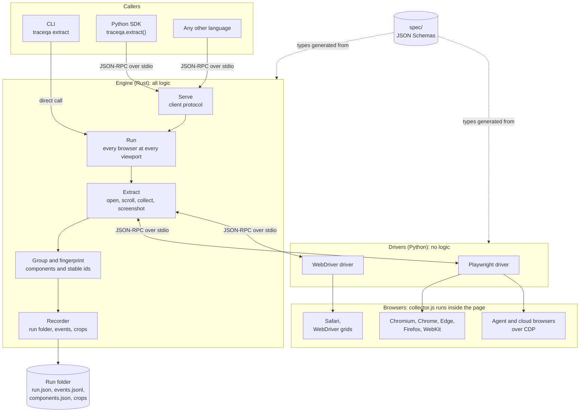

# Architecture

TraceQA is a set of small programs that exchange messages. One of them, the
engine, makes every decision. The others ask it for work or carry out its
instructions.

## Components

| Component | Language | Responsibility |
|---|---|---|
| Engine | Rust | Orchestration, grouping, identifiers, output. The only component that decides anything. |
| CLI | Rust | Turns arguments into a request and prints the result. Compiled into the same binary as the engine. |
| Drivers | Python | Control browsers. Each does what it is asked and reports what happened. |
| Collector | JavaScript | Runs inside the page and reports facts about its interactive elements. |
| SDKs | Any | Start the engine and exchange messages with it. They contain no logic. |
| Contracts | JSON Schema | Define every message and file format. |

## How programs communicate

Programs in different languages cannot call each other's functions. They
exchange messages instead:

- One program starts the other as a child process.
- They send JSON-RPC 2.0 messages through the child's standard input and
  standard output.
- Each message is one line of JSON.

Every mainstream language can start a process and read and write lines of text,
so any language can drive the engine and a driver can be written in any
language. The same approach is used by language servers and by the Model
Context Protocol.

The messages are defined in `spec/`. The Rust types are generated from the
schemas at build time and the Python types by `scripts/gen_python_protocol.py`,
so the two sides cannot drift apart. Every example in `spec/examples/` is
checked by the test suites of both languages.

## Client protocol

Between a caller and the engine. The caller starts `traceqa serve`.

| Step | Direction | Message | Purpose |
|---|---|---|---|
| 1 | caller to engine | `engine.hello` request | Exchange protocol versions. The engine refuses a mismatch. |
| 2 | engine to caller | response | Engine version and the features it can run. |
| 3 | caller to engine | `run.start` request | URL, browsers, viewports and options. |
| 4 | engine to caller | response | Run id and run folder. Sent immediately. |
| 5 | engine to caller | `run.event` notification, repeated | Progress. |
| 6 | engine to caller | `run.done` notification, once | Final status and the run manifest. |

`run.start` is answered as soon as the run is accepted, so the caller can cancel
it with `run.cancel` or start another while it executes. Each run executes on
its own thread.

The CLI does not use this protocol. It is compiled into the same binary and
calls the engine directly.

## Driver protocol

Between the engine and a driver. The engine starts the driver and is always the
caller.

| Method | Purpose |
|---|---|
| `driver.hello` | Exchange protocol versions and list the browsers the driver can open. |
| `session.open` | Open a browser at a viewport. Returns the browser version and its capabilities. |
| `page.goto` | Load a URL and wait until the page settles. |
| `page.eval` | Run a script in the page and, optionally, in every frame. |
| `page.scroll` | Scroll and wait until the page height is stable. |
| `page.screenshot` | Write a screenshot to a path the engine provides. |
| `session.close` | Close the session. |
| `driver.shutdown` | Close everything and exit. |
| `page.act` | Reserved for interaction. |

A driver may also send `driver.log` notifications.

### Driver selection

The engine holds a list of driver commands and no browser names. For a
requested browser it starts each driver in turn, reads the browsers listed in
its `driver.hello` response and uses the first driver that lists the browser.

### Capabilities

`session.open` returns what the session can do, for example whether it can
screenshot the full page or evaluate scripts in every frame. The engine adapts
to these flags. When a browser cannot screenshot the full page, `page.png` holds
the first screen instead of the whole page.

## One extraction, step by step

For each browser at each viewport:

1. The engine selects a driver and opens a session.
2. It loads the URL and waits for the page to settle: the load event, a quiet
   network, a stable page height, and no intro animation still running.
3. It goes through the page one screen at a time, the way a person scrolls. At
   each screen it runs the collector in the main page and every frame, and
   takes a screenshot. Scrolling loads lazy content and plays the animations
   that reveal sections.
4. Back at the top, it runs the collector once more. This reading is the list
   of elements.
5. It merges the frames. Elements in a frame are placed in page coordinates
   using the frame's position. A frame that cannot be read becomes a warning.
6. It groups elements into components and computes identifiers.
7. It cuts one crop per component from the screen that showed the most of it.
8. It writes `components.json` and `page.png`, and closes the session.

A target that fails does not stop the others. The session is closed whether or
not the extraction succeeded.

## The collector

`collector/collector.js` is a single JavaScript expression that evaluates to a
function. A driver evaluates it in each frame and returns the result.

It walks the document, including open shadow roots, and reports each interactive
element with its role, accessible name, a subset of attributes, selectors,
bounding box, state, structural path and the evidence for it being interactive.
It reports facts only. It does not group elements or assign identifiers.

It is plain JavaScript with no build step, so the engine embeds the file as it
is and the same code runs in every browser.

## Components and identifiers

An **element** is one interactive node. A **component** is a kind of element,
and each copy of it is an **instance**.

The identifier is `c_` followed by the first 12 hexadecimal characters of a
SHA-256 hash over the element's role, its normalised name and its structural
path. Position, size, class names, state, browser and viewport are excluded, so
the identifier does not change when they do.

Elements inside a repeated container, such as cards in a grid, share a path.
An item counts as a card when it holds at least two controls and at least three
items share that arrangement. When one place in the cards has at least three
different names, those names are treated as data and the elements become one
templated component. A list of single links, such as a footer, is not a set of
cards: each link is its own component.

The full recipe and its known limits are in
[spec/fingerprint.md](../spec/fingerprint.md).

## Output

The engine writes one run folder per run and emits each step as an event, both
to `events.jsonl` and live to the caller. Reporters and other tools read the run
folder and do not call back into the engine. The formats are described in
[usage.md](usage.md#output-files) and defined in `spec/run-folder.schema.json`.

## Design decisions

| Decision | Reason |
|---|---|
| The engine and the CLI are one Rust binary. | All logic lives in one place, so every driver and SDK behaves the same, and a single binary is simple to distribute. |
| Drivers are separate processes. | A driver holds no logic, so supporting a new browser never changes the engine. |
| The page is read by a script evaluated inside it. | It is the only code that runs identically in every browser. |
| Messages are JSON-RPC 2.0, one per line, over standard streams. | Every language can start a process and read and write lines. |
| JSON Schemas are the source of truth and types are generated. | The languages cannot disagree about a message. |
| The engine selects drivers by asking what they open. | The engine contains no browser names. |
| The engine works on structured data. Screenshots are evidence. | Data is small, exact and comparable across browsers. |
| Crops are cut from screenshots taken while scrolling through the page. | A single full-page screenshot misses content that animates in, or is pinned, as the page scrolls. It also needs no special ability from the browser. |
| The engine is a library crate with a thin CLI crate. | Other front ends can reuse the engine without depending on the CLI. |
| The engine uses threads and blocking pipes. | A run talks to one driver at a time, which needs no asynchronous runtime. |

## Changing a contract

1. Edit the schema in `spec/` and add or update an example in `spec/examples/`.
2. Run `uv run scripts/gen_python_protocol.py`. The Rust types regenerate on build.
3. Run `cargo test` and `uv run pytest`.

Adding an optional field is compatible. Any other change raises the contract's
version. The rules are in [spec/README.md](../spec/README.md).
